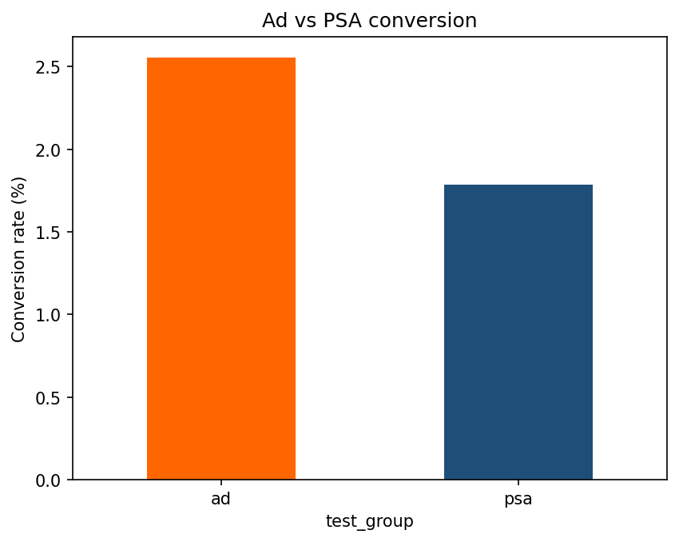

# Marketing Campaign A/B Test & Causal Analysis

Statistical evaluation of an ad campaign on **588,101 users**: did seeing the ad increase conversion compared with a neutral public-service announcement (PSA)?

**Tools:** Python, pandas, SciPy, statsmodels, matplotlib (run in Google Colab)

## Key results

| Metric | Ad group | PSA (control) |
|---|---|---|
| Users | 564,577 | 23,524 |
| Conversions | 14,423 | 420 |
| Conversion rate | **2.55%** | **1.79%** |

- **Absolute lift:** 0.77 percentage points
- **Relative lift:** 43.1%
- **Chi-square test of independence:** χ² = 54.32, df = 1, p ≈ 1.7 × 10⁻¹³ (significant at 95% confidence)
- **95% CI for the difference in conversion rate:** 0.59 to 0.94 percentage points
- **Minimum detectable effect (80% power, α = 0.05):** 0.255 pp (about 14.3% relative) given these group sizes
- **Power at the observed effect:** about 100%



## Dataset

Marketing A/B Testing dataset (Kaggle, by Favio Vázquez). Download `marketing_AB.csv` from Kaggle and place it next to the notebook. The data is not included in this repo.

Columns: `user id`, `test group` (ad / psa), `converted` (True/False), `total ads`, `most ads day`, `most ads hour`.

## Method

1. **Cleaning:** dropped the leftover index column, renamed columns, checked for missing values (0) and duplicate users (0).
2. **Group balance check:** compared average ads seen (24.82 vs 24.76) and day-of-week mix between groups.
3. **Conversion rates and lift:** absolute and relative.
4. **Chi-square test** on the 2×2 table of group × converted.
5. **Confidence interval** for the difference in proportions.
6. **Power / MDE analysis** (see limitations).

## Limitations

- The groups are highly unbalanced (about 96% ad / 4% PSA). The test remains valid, but the control group's estimate is less precise.
- The day-of-week mix differs slightly between groups (for example Thursday is about 16.6% of the PSA group vs 14.0% of the ad group). This is a minor imbalance worth noting.
- Power and MDE were calculated **after** the experiment on existing data, so they are a sensitivity analysis rather than a pre-registered sample-size plan.
- The causal reading relies on users having been randomly assigned. The dataset does not let me verify the assignment process.

## How to run

```bash
pip install -r requirements.txt
jupyter notebook marketing_ab_test.ipynb
```

## Author

Your Name · [LinkedIn](https://www.linkedin.com/) · your.email@example.com
